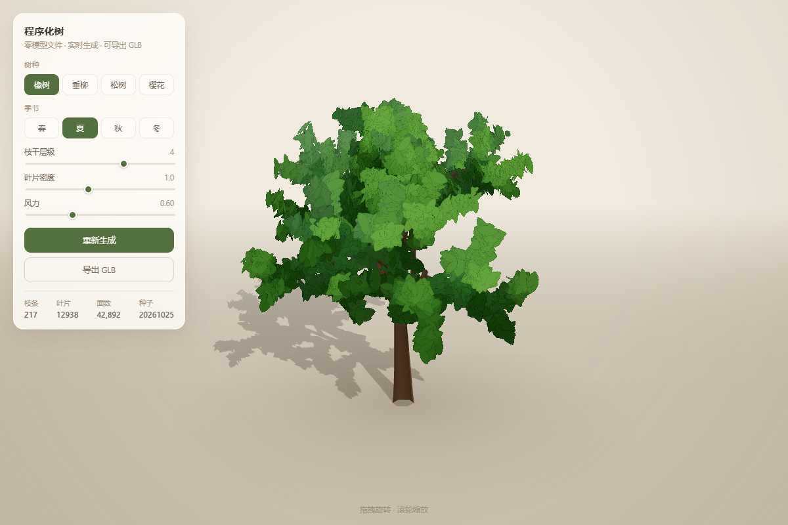

# 球形法线 3D 树建模

> 不用任何模型文件，在浏览器里用代码长出一棵树。
> 叶片的明暗不按「单片叶子」计算，而是把**一杈叶子当成一个球体**来着色。



---

## 0. 一句话说清核心思想

树叶是几千张卡片，如果每张卡片按自己的朝向打光，冠内会碎成一片噪点。
这里的做法是：**把同一根树杈上的叶子归为一组，用一个球心代替它们，
每片叶子的法线 = 球心指向该叶子的方向**。于是整丛叶子在光照下就像一个球，
明暗连续地铺过去，而不是每片各亮各的。

配套地，叶色只保留**一种**——形体完全交给法线的光照梯度去表达，不靠颜色变化。

---

## 1. 技术栈

| 层 | 选型 | 说明 |
|---|---|---|
| 运行时 | 原生 JavaScript（ES5 语法 + IIFE） | 无构建、无打包、无框架 |
| 3D 引擎 | three.js **r159**（UMD 版） | 本地 `vendor/three.min.js`，不走 CDN |
| 渲染 | WebGL2 / `WebGLRenderer` | 阴影 `PCFSoftShadowMap`，色调映射 `ACESFilmic` |
| 几何 | 手写 `BufferGeometry` | 管道网格自己拼顶点与索引，不用现成 Tube |
| 着色 | `ShaderMaterial` 注入 | 用 `onBeforeCompile` 改写 three 内置 PBR 着色器 |
| 贴图 | Canvas 2D 程序化生成 | 叶片轮廓现场画，无图片资源 |
| 实例化 | `InstancedMesh` + 自定义实例属性 | 几万片叶子一次 draw call |
| 导出 | 手写 glTF 2.0 二进制打包 | 不依赖 `GLTFExporter` |
| 验证 | Edge 无头截图 + Node 自检 + Blender 导入 | 全链路可复现 |
| 构建 | **无** | 双击 `index.html` 即可运行 |

### 为什么是 UMD 版而不是 ES Module

three.js 的 `examples/jsm` 在 UMD 版里**不存在**——没有 `OrbitControls`、
`GLTFExporter`、`BufferGeometryUtils`。代价是四块东西必须自己写：

- 轨道控制（相机绕目标点转）
- 管道几何（沿曲线扫掠圆截面）
- 多段几何合并（累加顶点/索引数组）
- GLB 打包（按规范拼二进制块）

换来的是：`file://` 双击直接跑，不需要 `npm`、不需要起本地服务器、不依赖网络。
这个取舍在文末「局限」里还会再提。

---

## 2. 目录结构

```
procedural-tree/
├── index.html              页面外壳 + UI + 样式
├── vendor/
│   └── three.min.js        three r159 UMD
├── src/
│   ├── noise.js            mulberry32 伪随机 + 3D Perlin 噪声
│   ├── tree.js             骨架生成 + 管道几何 + 叶片纹理
│   ├── export.js           自写 glTF 2.0 GLB 打包器
│   └── main.js             场景 / 光照 / 控制 / UI / 动画
└── test/
    └── verify-export.js    Node 端跑通生成→导出并校验容器
```

`tree.js` 是纯计算，不碰场景；`main.js` 只负责把结果塞进 three 并上屏。
这个切分让 `tree.js` 可以在 Node 里脱离浏览器跑（自检脚本就是这么做的）。

---

## 3. 整条管线

```text
  参数（树种 / 季节 / 种子 / 枝干层级 / 叶片密度）
                  │
                  ▼
      ┌───────────────────────┐
      │ ① 骨架生成  tree.js    │  samplePath：噪声扰动 + 向光性 + 重力
      │                       │  → branches[]  每根枝 = 一串三维点
      │                       │  → leaves[]    每片叶 = 一个 4×4 矩阵
      │                       │  → leafClusterIds[]  这片叶属于哪一杈
      └──────────┬────────────┘
                 │
        ┌────────┴─────────┐
        ▼                  ▼
 ┌─────────────┐    ┌──────────────────┐
 │ ②a 管道几何  │    │ ②b 叶片实例      │
 │ 沿曲线扫圆管 │    │ InstancedMesh    │
 │ 全部合并成一个│    │ 单色 + 实例矩阵   │
 │ BufferGeometry│   │                  │
 └──────┬──────┘    └────────┬─────────┘
        │                    │
        ▼                    ▼
 ┌─────────────┐    ┌──────────────────────┐
 │ ③ Mesh      │    │ ③' 球形法线          │
 │ 顶点色当 AO │    │ 法线 = 叶位 − 杈心    │
 └──────┬──────┘    └──────────┬───────────┘
        └──────────┬───────────┘
                   ▼
         ┌──────────────────┐
         │ ④ 渲染 / 交互 / 风 │
         └────────┬─────────┘
                  ▼
         ┌──────────────────┐
         │ ⑤ 导出 .glb       │
         └──────────────────┘
```

---

## 4. 骨架：树是怎么「长」出来的

### 4.1 一根枝 = 一串点，每走一步改一次方向

所有弯曲都来自同一个函数 `samplePath()`。它不预设曲线，而是**逐步前进、每步重新决定方向**：

```js
for (let i = 1; i <= segs; i++) {
  // ① 噪声扰动：让枝条自然地歪扭
  const nx = noise.noise(p.x * ns + 31.7, p.y * ns, p.z * ns);
  const ny = noise.noise(p.x * ns + 7.1,  p.y * ns, p.z * ns + 53.9);
  const nz = noise.noise(p.x * ns,       p.y * ns + 17.3, p.z * ns);

  const nvec = new THREE.Vector3(nx, ny * 0.55, nz);
  nvec.addScaledVector(d, -nvec.dot(d));   // ← 关键：剔除沿枝方向的分量
  d.addScaledVector(nvec, sp.wander * (0.45 + lf * 0.95) * 0.075);

  // ② 向光性：越往树冠外层越往天上长
  d.y += sp.tropism * 0.020 * (0.35 + lf);

  // ③ 重力：越细的枝垂得越厉害
  const gBias = sp.gravityBase || 0;
  d.y -= sp.gravity * (gBias + (1 - gBias) * lf) * 0.030;

  d.normalize();
  p.addScaledVector(d, step);
  pts.push(p.clone());

  if (p.y < 0.06) break;   // 触地即止
}
```

三个要点：

**① `nvec.addScaledVector(d, -nvec.dot(d))` 这一步不能省。**
它把噪声向量里「沿着枝条方向」的分量减掉，只留下垂直分量。
如果不做，噪声会让枝条忽快忽慢地伸缩，看起来像抽搐而不是弯曲。

**② 三种力的叠加顺序决定了树的性格。**
`tropism`（向上）和 `gravity`（向下）是两个相反的拉力，它们的比值就是树的姿态：

- 橡树 `gravity: 0.60 / tropism: 1.0` → 向上为主，枝条舒展
- 垂柳 `gravity: 3.20 / tropism: 0.50` → 向下为主，枝条拱垂

**③ 垂柳多了一个 `gravityBase`。**
默认重力只作用在细枝（`lf = level / maxLevel`），主枝几乎不弯。
柳树要的不是「枝尖下垂」，而是「整条枝拱下去」，所以给它一个不随层级衰减的基准重力：

```js
d.y -= sp.gravity * (gBias + (1 - gBias) * lf) * 0.030;
//                 柳树 gBias = 0.5，主枝也有 50% 的重力
```

### 4.2 主干与主枝：为什么不是「从顶部分叉」

最初的做法是让主干一路长到顶再分成 3 根——结果树冠像蘑菇，顶部还会冒出尖刺。
现在的结构是：

```text
        顶梢（1 根）
          │
    ╱╲    │    ╱╲      ← 主枝：在主干 46%~92% 高度处轮生
   ╱  ╲   │   ╱  ╲        每根往上扬的角度不同
  ╱    ╲  │  ╱    ╲
 ╱      ╲ │ ╱      ╲
─────────█████────────  ← 主干（一根，贯通到顶）
```

关键参数是 `limbRise: [下, 上]`——**下部主枝平展、上部主枝上扬**，才形成穹顶状的冠。
这个顺序写反（下陡上平）会立刻变成蘑菇头 + 顶部尖刺，是整个项目里最容易搞错的一处。

主枝长度 `limbLen: [下, 上]` 同理：下部最长、上部最短，冠形才收得住。

### 4.3 松树为什么单独一套拓扑

松树不是「瓶状冠」，是锥形。所以它走 `habit: 'conical'` 分支：

```text
       ▲       顶梢 3 根短枝收口
      ╱│╲
     ──┼──    ← 轮生层：沿主干每 1/15 高度长一圈
    ╱  │  ╲      每层 3~4 根，方位均分
   ────┼────
  ╱    │    ╲
 ══════╪══════  ← 主干粗细贯穿
```

每层的方位角是**均分**的（`(k/n) * 2π`），不是随机撒。
随机撒会出现某一侧整段空缺，看起来像被啃掉一块。

### 4.4 递归分叉

一根枝长完后，在它 34%~98% 的区间上生 2~3 根子枝：

```js
const azim = (i / count) * TAU + GOLDEN * level * 1.7 + rnd() * 0.85;
const pitch = degToRad(sp.branchAngle * (0.72 + rnd() * 0.62));

const dirC = tan * cos(pitch)                 // 沿母枝方向的分量
           + ax  * sin(pitch) * cos(azim)     // 绕母枝散开
           + ay  * sin(pitch) * sin(azim);
dirC.y += sp.childRise;
```

- **方位均分 + 黄金角偏移**：同一根母枝上的子枝不会挤在一侧；不同层级的偏移量不同，
  避免所有层级的子枝在同一个方向排成一条线。
- **半径衰减** `radiusRatio ≈ 0.6`、**长度衰减** `lengthRatio ≈ 0.7`：
  每一级都更细更短，直到最末梢。
- `ternary` 控制「三叉」的概率。橡树 0.80、樱花 0.78，几乎都三分叉，
  末梢数量上去了，冠才够密。

### 4.5 分杈编号（为球形法线铺路）

这是全篇最关键的一处埋点。生长时每个子枝会携带一个 `gid`（group id）：

```js
// 到「分杈层」时，每个子树领一个新的编号，之后所有后代都继承它
const childGid = (level === clusterLevel - 1) ? (gidCounter++) : gid;
grow(origin, dirC, L, r, level + 1, childGid);
```

撒叶子时把这个 `gid` 记下来：

```js
leaves.push(m);
leafClusterIds.push(gid);
```

于是每片叶子都知道自己属于哪一「杈」。第 7 章会用它算球心。

---

## 5. 从点到面：把骨架变成管子

骨架只有点，没有体积。`buildTrunkGeometry()` 把每根枝扫成一个管状网格，
**所有枝合并进同一个 `BufferGeometry`**——一棵树只有一次 draw call。

### 5.1 平行传输标架，而不是 Frenet 标架

要在曲线上放圆截面，得为每个点配一组「法线 + 副法线」。
用经典 Frenet 标架会在曲率突变处**突然翻转**，管子表面会出现麻花状的扭曲。

这里用的是**平行传输（parallel transport）**：把上一个点的法线投影到当前点的切平面上，
再归一化。这样标架是「尽量不转」地延续下去的：

```js
nrm.addScaledVector(tan, -nrm.dot(tan));   // 投影到当前切平面
if (nrm.lengthSq() < 1e-8) {               // 万一退化，重新取一个垂直向量
  ref = Math.abs(tan.y) > 0.9 ? X : Y;
  nrm.crossVectors(tan, ref);
}
nrm.normalize();
tmpB.crossVectors(tan, nrm).normalize();
```

### 5.2 环形截面与索引

每个采样点放一圈 `RAD = 6` 个顶点（实际存 7 个，首尾重复一份，UV 才不会接缝）：

```js
const r = b.r0 + (b.r1 - b.r0) * Math.pow(t, 0.72);   // 半径沿长度衰减
const nx = nrm.x * ca + tmpB.x * sa;                  // 圆上一点的方向
positions.push(pts[i].x + nx * r, ...);
normals.push(nx, ny, nz);                             // 法线就是径向
uvs.push(j / RAD, t * 2);
```

索引按「相邻两圈连梯形」生成，顶点基址 `vBase` 逐枝累加，实现多段合并：

```js
indices.push(a, c, a + 1, a + 1, c, c + 1);
vBase += n * (RAD + 1);
```

半径指数 `Math.pow(t, 0.72)` 让靠根部更粗、越往上收得越慢——比线性插值自然。

### 5.3 用顶点色伪造 AO

没有烘焙、没有 SSAO，体积感靠顶点色：

```js
const levelDark = Math.min(0.42, b.level * 0.075);            // 枝越细越暗
const shade = 0.55 * (1 - levelDark) + 0.45 * (1 - Math.abs(ca) * 0.35);
col.copy(woodDark).lerp(woodLight, shade * (0.75 + 0.25 * (1 - t)));
```

`ca` 是圆周角的余弦——它正是「法线朝向」的近似，所以背光面天然更暗。
配合 `vertexColors: true` 的 `MeshStandardMaterial`，一层免费的明暗就出来了。

---

## 6. 叶片

### 6.1 轮廓用 Canvas 现场画

没有任何图片文件。四种轮廓（阔叶 / 柳叶 / 针叶 / 花瓣）都是 `canvas` 上的几条贝塞尔曲线：

```js
// 阔叶：宽约 0.6S 的窄长叶
g.moveTo(S / 2, 4);
g.bezierCurveTo(S * 0.80, S * 0.22, S * 0.82, S * 0.72, S / 2, S - 4);
g.bezierCurveTo(S * 0.18, S * 0.72, S * 0.20, S * 0.22, S / 2, 4);
g.fill();
```

花瓣多一步：用 `globalCompositeOperation = 'destination-out'` 在顶端挖一个小缺口，
樱花的花瓣才有那个特征性的凹口。

**整块填纯白**，不画渐变也不画叶脉——因为最终颜色完全由实例色决定，
贴图带明暗会和「单色」的目标打架。

### 6.2 一片叶 = 一个 4×4 矩阵

叶片的朝向不用欧拉角，直接构造基向量再组成矩阵：

```js
const nrm   = 朝外 + 向上偏置 + 随机扰动;      // 叶面朝向
const right = up × nrm;
const up2   = nrm × right;

const m = new Matrix4().makeBasis(right, up2, nrm);  // 局部 XY 面朝向 nrm
m.multiply(new Matrix4().makeRotationZ(rnd() * TAU)); // 绕自身法线随机滚转
if (sp.leafDroop) m.multiply(new Matrix4().makeRotationZ(Math.PI));  // 柳叶倒挂
m.scale(new Vector3(s, s * (0.9 + rnd() * 0.25), s));
m.setPosition(pos);
```

`PlaneGeometry` 默认躺在 XY 平面、法线朝 +Z，所以 `makeBasis(right, up2, nrm)`
正好把它的 +Z 轴对准 `nrm`。

### 6.3 分三层撒叶，别只撒在枝尖

最初只在最末梢撒叶，结果每根枝都是「光杆挂一个绒球」，冠内到处是洞。
现在按层级给不同密度：

```js
if (level >= maxLevel)        scatterLeaves(pts, 1.00, gid);  // 末梢，满密度
if (level === maxLevel - 1)   scatterLeaves(pts, 0.62, gid);  // 倒数第二层，补
if (level === maxLevel - 2)   scatterLeaves(pts, 0.14, gid);  // 再上一层，只补缝隙
```

`leafStart` 控制从枝条的哪个位置开始长叶。柳树是 `0.02`（几乎从根部就有叶子，
因为柳条整条都挂叶），橡树是 `0.14`。

### 6.4 为什么只用一种颜色

每个树种每个季节只存**一个色值**：

```js
palette: {
  spring: '#93c25e',
  summer: '#569b3f',
  autumn: '#d79c3c',
  winter: '#9a8a70'
}
```

所有叶子 `setColorAt(i, 同一个Color)`。

这不是偷懒，而是**和球形法线配套的必要条件**：如果每片叶子颜色都不同，
色差会和法线明暗混在一起，冠内看起来就是一团杂色；只有底色统一，
球面法线带来的明暗渐变才能被读成「体积」。

---

## 7. 核心：球形法线

### 7.1 要解决的问题

几千张卡片各自按自己的法线打光，会得到两种坏结果：

1. **碎**——相邻叶片明暗跳变，冠内像撒了胡椒面
2. **假**——叶片是平面，正对光源的叶片整片死白，侧对的整片死黑

而人眼看一团树叶时，感知的不是单片叶子，而是**那团叶子的整体体积**。
所以要反过来：先假装这团叶子是一个球，再按球面算明暗。

### 7.2 分组：一「杈」叶子 = 一个球

用 4.5 节埋下的 `gid` 分组。生成结束后按组求重心：

```js
const groupSum = new Map();
for (let i = 0; i < leaves.length; i++) {
  const p = new THREE.Vector3().setFromMatrixPosition(leaves[i]);
  const g = leafClusterIds[i];
  let e = groupSum.get(g);
  if (!e) { e = { c: new THREE.Vector3(), n: 0 }; groupSum.set(g, e); }
  e.c.add(p);
  e.n++;
}
groupSum.forEach(e => e.c.multiplyScalar(1 / e.n));   // 组重心
```

分组粒度由 `clusterLevel` 控制，取值就是「在第几层开一个新组」：

| `clusterLevel` | 一组的范围 | 效果 |
|---|---|---|
| `1` | 主干上的一整根主枝 | 只有 5~6 个球，整冠变成平板 |
| `2` | 主枝分出来的二级杈 | 十几到几十个球，**实测最佳** |
| `3` | 更细的枝 | 球太多太小，又回到「碎」 |

松树是 `1`（按轮生层分组，一层一个球），因为它的枝本来就短。

### 7.3 法线 = 球心指向叶子

球面的法线方向就是半径方向。所以每片叶子的法线是：

```glsl
vec3 dir = 叶子位置 − 组重心;
objectNormal = normalize(dir);
```

同一组里所有叶子共享同一个球心，法线随位置连续变化 → 整组看起来是一个球。

### 7.4 着色器注入：四处替换

three 的 `MeshStandardMaterial` 不接受「自定义法线来源」，所以要在
`onBeforeCompile` 里改写它编译前的着色器源码。一共动四处：

**① 声明实例属性**

```js
shader.vertexShader =
  'uniform float uTime;\nuniform float uWind;\nattribute vec3 aClusterCenter;\n' +
  shader.vertexShader;
```

**② 换掉法线的起点**（`beginnormal_vertex`）

原本是 `vec3 objectNormal = vec3( normal );`，改成从球心算：

```glsl
vec3 objectNormal;
#ifdef USE_INSTANCING
  vec3 sphOrigin = vec3(instanceMatrix[3][0], instanceMatrix[3][1], instanceMatrix[3][2]);
  vec3 sphDir = sphOrigin - aClusterCenter;
  float sphLen = length(sphDir);
  objectNormal = sphLen > 1e-4 ? sphDir / sphLen : vec3(0.0, 1.0, 0.0);
#else
  objectNormal = vec3(0.0, 0.0, 1.0);
#endif
```

`instanceMatrix[3]` 是实例矩阵的平移列，也就是这片叶子在树空间里的位置。

**③ 跳过实例矩阵对法线的旋转**（`defaultnormal_vertex`）

这一步最容易漏。three 默认会对法线再做一次 `instanceMatrix` 的旋转，
但我们的法线**已经在树空间里**了，再转一次就错。所以整段替换掉：

```glsl
vec3 transformedNormal = normalMatrix * objectNormal;
#ifdef FLIP_SIDED
  transformedNormal = -transformedNormal;
#endif
```

**④ 禁止双面材质翻转法线**（片元阶段）

`side: DoubleSide` 时 three 会按面朝向翻转法线：

```glsl
#ifdef DOUBLE_SIDED
  normal *= faceDirection;   // gl_FrontFacing ? 1 : -1
#endif
```

叶片正反面朝向随机，这一翻就把球形法线打碎了一半。所以要在
`normal_fragment_begin` 之后强行改回来：

```glsl
#include <normal_fragment_begin>
#ifndef FLAT_SHADED
  normal = normalize( vNormal );
#endif
```

### 7.5 两个必须绕开的坑（复述，因为太容易踩）

| 坑 | 症状 | 处理 |
|---|---|---|
| 法线被实例矩阵再转一次 | 同一球面上的叶子明暗乱跳 | 整段替换 `defaultnormal_vertex` |
| 双面材质按面朝向翻法线 | 一半叶子亮、一半叶子黑 | 片元阶段强制 `normal = vNormal` |

这两个坑的共同点：**球形法线假设「法线是全局一致的场」，任何让它随叶子局部状态变化的东西都要掐掉。**

### 7.6 光照必须配合，否则等于没做

这是调参调出来的结论，值得单列。

**主光必须在 45° 左右。**
最初主光在正上方 `(3.0, 9.6, 2.2)`——球形法线全部朝上，整片树冠收到相同强度的光，
看起来就是一张绿色纸片。改成 `(6.2, 5.4, 4.6)` 之后，明暗分界才出现。

**光比要收敛。**
球形法线让明暗过渡变缓，如果主光过强，受光面会直接过曝成白：

```js
hemi  = 0.95   // 半球光，负责填暗部
key   = 2.30   // 主光，负责塑形
fill  = 0.50   // 补光，从背面勾勒
exposure = 1.02
```

### 7.7 代价：会变「平」

单色 + 平滑法线，必然丢掉叶子层面的细节。远看是干净的团块，近看是平涂色块。
这是这个方案的固有代价，不是 bug。若需要层次，见文末「下一步」的两条路。

---

## 8. 阴影

### 8.1 叶片投影必须带 alphaTest

叶片是带镂空贴图的卡片。three 计算阴影时用的是深度材质，
如果深度材质不知道 `alphaTest`，投出来的影子就是**整块方形**。

所以要显式指定：

```js
leafMesh.customDepthMaterial = new THREE.MeshDepthMaterial({
  depthPacking: THREE.RGBADepthPacking,
  map: tex,            // ← 必须带上，否则 alphaTest 无从判断
  alphaTest: 0.45
});
```

`map` 和 `alphaTest` 两个都要给，只给 `alphaTest` 仍然会投方片。

### 8.2 关闭叶片之间的自阴影

```js
leafMesh.castShadow = true;
leafMesh.receiveShadow = false;   // ← 关键
```

叶片互相投影会在冠内打出大量细小暗斑——这和「把一杈叶子当成一个整体」
是矛盾的。关掉之后冠内是干净的球面渐变，只有树对地面、树干对地面还有影子。

### 8.3 接地阴影贴片

除了真实的平行光阴影，地面还铺了一张径向渐变贴片，压在树根处，
弥补「阴影边缘太硬、树像浮在空中」的问题：

```js
const aoMesh = new THREE.Mesh(
  new THREE.PlaneGeometry(1, 1),
  new THREE.MeshBasicMaterial({ map: aoTex, transparent: true, depthWrite: false, opacity: 0.30 })
);
aoMesh.rotation.x = -Math.PI / 2;
aoMesh.position.y = 0.004;   // 略高于地面，避免 z-fighting
```

尺寸随树冠自动缩放（`fit.radius * 2.4`）。

---

## 9. 风

风写在顶点着色器里，JS 每帧只更新一个时间 uniform：

```glsl
#ifdef USE_INSTANCING
  vec3 iOrigin = vec3(instanceMatrix[3][0], instanceMatrix[3][1], instanceMatrix[3][2]);
  float ph = iOrigin.x * 2.13 + iOrigin.z * 2.71 + iOrigin.y * 1.37;   // 用位置当相位
  float s1 = sin(uTime * 1.62 + ph);
  float s2 = sin(uTime * 2.86 + ph * 1.73);
  float amp = uWind * 0.085 * (0.35 + 0.65 * (position.y + 0.5));      // 叶尖摆幅更大
  transformed.x += s1 * amp;
  transformed.z += cos(uTime * 1.23 + ph * 1.19) * amp * 0.78;
  transformed.y += s2 * amp * 0.28;
#endif
```

关键是 `ph`：用**实例在空间中的位置**当相位，而不是随机数。
这样相邻叶子的摆动是连续的、有波的传播感；用随机数则是各自乱抖。

整个冠还会做一个极小幅度的整体摇摆（`leafMesh.rotation.z`），
让「一冠叶子」作为一个整体呼吸。

---

## 10. 自动取景

相机距离不是写死的，而是按树的实际包围盒反推，保证「树占画面 58%」：

```js
const tanV = Math.tan(degToRad(camera.fov * 0.5));
const tanH = tanV * camera.aspect;
const fill = 0.58;

const distV = (fit.height * 0.5) / (tanV * fill);   // 受高度约束
const distH = fit.radius / (tanH * fill);           // 受冠幅约束
ctrl.dist = clamp(Math.max(distV, distH), 3.8, 24);
```

`fit` 在生成阶段就统计好了（`maxY`、`maxXZ`、冠心水平位置）。
横向还要把视线中心对齐到**冠心**而不是树干——树冠通常不是正圆，
对齐树干会让整棵树偏到画面一侧。

> 调参记录：`fill` 从 0.74 一路降到 0.58。太高时窄而高的松树会小得可怜，
> 宽而低的垂柳会出画。0.58 是四种树都能接受的折中。

---

## 11. 交互与生长动画

**轨道控制**六十行手写：球坐标 `(az, el, dist)` + 拖拽惯性 + 闲置 3 秒自动旋转。

**生长动画**不重建几何，只改两个「可见量」：

```js
grow.active && (
  trunkMesh.geometry.setDrawRange(0, floor(idxCount * e / 3) * 3),
  leafMesh.count = floor(total * e)          // InstancedMesh 的 count 可动态改
);
```

`e` 是 `easeOutCubic` 缓动。树干用 `drawRange` 从根部往前「画」，
叶片用 `count` 逐片显现——成本几乎为零，观感上就是树在长大。

---

## 12. 导出 GLB

### 12.1 为什么自己写

`GLTFExporter` 在 `examples/jsm` 里，UMD 版拿不到。要么改用 ES Module
（丢掉 `file://` 直接运行），要么自己按 glTF 2.0 规范打包。选了后者。

### 12.2 二进制布局

GLB 就是一个头部 + 两个块，规则很简单：

```text
┌───────────────┬──────────┬─────────────────────────┐
│ magic  'glTF' │ 4 bytes  │ 0x46546C67              │
│ version   2   │ 4 bytes  │                         │
│ totalLength   │ 4 bytes  │ 整个文件长度             │
├───────────────┼──────────┼─────────────────────────┤
│ chunk0 length │ 4 bytes  │ 必须是 4 的倍数          │
│ chunk0 type   │ 4 bytes  │ 'JSON' = 0x4E4F534A     │
│ JSON 数据      │ n bytes  │ 尾部补空格 0x20 对齐     │
├───────────────┼──────────┼─────────────────────────┤
│ chunk1 length │ 4 bytes  │ 必须是 4 的倍数          │
│ chunk1 type   │ 4 bytes  │ 'BIN\0' = 0x004E4942    │
│ 二进制数据     │ n bytes  │ 尾部补 0x00 对齐         │
└───────────────┴──────────┴─────────────────────────┘
```

写的时候有个细节：每段二进制数据落盘前必须 4 字节对齐，
所以 `pushBytes()` 里先补 padding 再记录 `byteOffset`：

```js
function pushBytes(bytes) {
  const pad = (4 - (offset % 4)) % 4;
  if (pad) { bin.push(new Uint8Array(pad)); offset += pad; }
  const start = offset;
  bin.push(bytes);
  offset += bytes.byteLength;
  return { byteOffset: start, byteLength: bytes.byteLength };
}
```

### 12.3 属性与材质

一棵树导出为**两个 primitive、两个材质**：

| primitive | 属性 | 材质 |
|---|---|---|
| `trunk` | POSITION / NORMAL / TEXCOORD_0 / COLOR_0 | 顶点色 + PBR，无贴图 |
| `leaves` | POSITION / NORMAL / TEXCOORD_0 / COLOR_0 | 内嵌 PNG + `alphaMode: MASK` |

叶片贴图以 PNG 形式**内嵌进 BIN 块**，通过 `images[].bufferView` 引用，
不产生外部依赖：

```js
const bytes = b64ToBytes(canvas.toDataURL('image/png'));
const bv = pushBytes(bytes);
gltf.images.push({ bufferView: bvIndex, mimeType: 'image/png', name: 'leaf' });
gltf.textures.push({ sampler: ..., source: imageIndex });
// 材质里：
material.alphaMode = 'MASK';
material.alphaCutoff = 0.45;
```

### 12.4 实例烘焙

`InstancedMesh` 不是 glTF 概念。导出前要把每个实例展开成真实顶点，
并且**法线也换成球形法线**，否则别的软件打开会看到每片叶子各亮各的：

```js
if (instNormals && instNormals[i]) {
  const sn = instNormals[i];              // 该叶所属球面的法线
  normals[...] = sn.x; normals[...] = sn.y; normals[...] = sn.z;
} else {
  v.fromBufferAttribute(srcN, k).applyMatrix3(nm).normalize();  // 常规做法
}
```

### 12.5 `normalized` 这个坑

顶点色为了省空间，用 `UNSIGNED_BYTE` 存（每通道 1 字节）。
但 glTF 规范要求：**整型颜色 accessor 必须标 `normalized: true`**，
否则数值会被当作 0~255 的真实颜色，直接被截断成白色。

```js
if (normalized) acc.normalized = true;   // COLOR_0 传 true
```

这个 bug 很隐蔽：three 里看得好好的，Blender 导入也不报错，
但模型一片雪白。修复后用 Blender 读顶点色验证过：
`(0.22, 0.125, 0.063)` —— 正是木头的棕。

### 12.6 坐标系与 UV

glTF 和 three 都是 **Y 轴向上、右手系**，所以位置和法线可以直接搬，不需要转轴。
UV 直接沿用 `PlaneGeometry` 的原始 UV。

---

## 13. 怎么验证的

三层，缺一层都可能漏 bug：

**① 无头浏览器截图**（看画面）

```bash
msedge.exe --headless --no-sandbox \
  --enable-unsafe-swiftshader --use-gl=angle --use-angle=swiftshader \
  --window-size=1200,800 --virtual-time-budget=11000 \
  --screenshot=out.png \
  "file:///C:/.../index.html#instant=1&noauto=1&species=oak&season=summer&seed=7"
```

页面支持 URL 参数（`species / season / seed / level / density / instant / noauto / az / el / dist`），
所以每一张截图都是**可复现**的。

> 注意：本机 Edge 的 `--headless=new` 起不来（报「无法在非交互式会话中打开」且进程被 SIGTERM），
> 必须用旧版 `--headless` + swiftshader 软渲染。中文路径要先 `encodeURI`。

**② Node 端结构自检**（看数据）

`test/verify-export.js` 在 Node 里用桩替身顶掉 `document` / `canvas`，
跑完整条生成→烘焙→打包链路，然后校验：

- magic / version / 总长度
- 两个 chunk 的类型与 4 字节对齐
- 每个 `bufferView` 不越界
- 每个 `accessor` 的字节数不超过其 `bufferView`
- `POSITION` 必须带 `min/max`
- primitive 的 `material` 索引不越界

**③ Blender 实际导入**（看能不能用）

```bash
blender.exe -b --python-expr "
import bpy
bpy.ops.wm.read_factory_settings(use_empty=True)
bpy.ops.import_scene.gltf(filepath=r'...\verify-tree.glb')
print([o.name for o in bpy.data.objects])
"
```

实测结果：约 1.4 万顶点、1.2 万面、UV 齐全、`trunk` + `leaves` 双材质、
贴图内嵌成功、顶点色读出来是 0~1 浮点（木头的棕）。

---

## 14. 参数表

`SPECIES` 里每个字段的含义：

| 字段 | 作用 | 调它的效果 |
|---|---|---|
| `habit` | `spreading` / `conical` | 决定走「瓶状冠」还是「锥形」拓扑 |
| `trunkHeight` | 主干高度 | 整体尺寸 |
| `trunkRadius` | 主根基半径 | 粗壮感 |
| `limbs` | 主枝数量 | 冠的丰满度 |
| `limbRise` | `[下部, 上部]` 上扬系数 | **冠形**，写反会变蘑菇 |
| `limbLen` | `[下部, 上部]` 主枝长度 | 下部越长冠越展 |
| `maxLevel` | 递归层数 | 细节量、面数 |
| `ternary` | 三分叉概率 | 末梢数量 → 冠的密度 |
| `branchAngle` | 子枝张开角（度） | 紧凑 / 松散 |
| `lengthRatio` | 子枝长度衰减 | 末梢收敛速度 |
| `radiusRatio` | 子枝半径衰减 | 枝条粗细过渡 |
| `taper` | 单根枝自身的收细 | 视觉上的「梢」 |
| `gravity` | 重力下垂强度 | 挺立 / 柔垂 |
| `gravityBase` | 重力的层级基准（柳树专用） | 整条枝拱垂 |
| `tropism` | 向光性（向上） | 枝条的「求光感」 |
| `wander` | 噪声弯曲强度 | 僵直 / 虬曲 |
| `noiseScale` | 噪声采样尺度 | 大弯曲 / 小抖动 |
| `clusterLevel` | 球形法线的分组层级 | 球的粒度，见 7.2 |
| `leafShape` | `broad`/`willow`/`needle`/`petal` | 叶轮廓 |
| `leafSize` | 叶片尺寸 | 尺度感 |
| `leavesPer` | 每根末梢枝的叶片基数 | 冠的疏密 |
| `leafStart` | 从枝的哪一段开始长叶 | 露不露枝 |
| `leafUp` | 叶面朝上的偏置 | 平摊 / 直立 |
| `leafDroop` | 叶尖朝下（柳） | 垂坠感 |
| `palette` | 每季一个色值 | 季节 |

季节参数（`SEASONS`）只有三项：`density`（密度倍率）、`size`（尺寸倍率）、`label`。
冬天是 `density: 0.15` —— 残叶 + 裸枝，正好用来观察骨架。

---

## 15. 踩坑清单

按踩到的顺序：

1. **主枝上扬角度写反** → 树冠变蘑菇头 + 顶部尖刺。必须「下平上陡」。
2. **叶片只撒末梢** → 光杆挂绒球。要在 `maxLevel-1` / `maxLevel-2` 补。
3. **垂柳只有枝尖下垂** → 需要 `gravityBase` 让重力对所有层级生效。
4. **枝条穿进地面** → `samplePath` 里 `p.y < 0.06` 就 break。
5. **叶片阴影是方片** → `customDepthMaterial` 必须同时设 `map` + `alphaTest`。
6. **冠内全是噪点** → 关掉 `leafMesh.receiveShadow`。
7. **球形法线不生效** → 检查是否漏了替换 `defaultnormal_vertex`（被实例矩阵又转了一次）。
8. **一半叶子发黑** → 双面材质的 `faceDirection` 翻转，要在片元阶段改回 `vNormal`。
9. **树冠像纸片** → 主光太靠正上方，压到 45°。
10. **受光面死白** → 光比太大，半球光 / 主光 / 曝光一起收。
11. **松针全是盐噪点** → 球形法线管不了剪影噪声，只能加大针叶（0.16→0.23）并减数量（32→20）。
12. **窄高的松树小得可怜** → 不要用固定放大系数，按「占画面 58%」反推距离。
13. **GLB 一片雪白** → 整型颜色 accessor 漏了 `normalized: true`。
14. **Edge `--headless=new` 起不来** → 用旧版 `--headless` + swiftshader。

---

## 16. 局限与下一步

### 现在的局限

- **形态依赖随机种子**。少数种子会长出偏心的树（枝条都往一侧走），得「重新生成」挑。
- **没有 LOD**。一棵橡树约 4.3 万三角面，近景没问题，放几十棵到场景里就该分档了。
- **单色 + 平滑法线偏平**，近看是平涂色块（这是方案本身的代价）。
- **没有真正的自遮挡**。冠内的暗部完全靠法线梯度伪造，转到背光面才会变暗。
- **导出的 GLB 不含骨骼/动画**，风摆是着色器行为，导出即静止。

### 两条可选的改进路线

**① 法线混合（最省事）**

球形法线保留 75%，混入 25% 的叶片自身朝向：

```glsl
objectNormal = normalize(mix(sphereNormal, leafPlaneNormal, 0.25));
```

整体体积感还在，但每片叶子会各自吃光，层次立刻回来。一行代码。

**② 按冠心距离做单色 AO**

按叶子到球心的距离压暗，但只动明度、不动色相——严格来说仍是「一种颜色」，
却能补回冠内的深度。这比混色更符合「单色」的初衷。

### 如果想继续往下做

- **LOD**：按 `maxLevel` 和 `leavesPer` 生成 2~3 档，用 `THREE.LOD` 挂。
- **实例化森林**：一棵树已经是一次 draw call，森林可以再把树本身实例化，
  配 `InstancedBufferAttribute` 传每棵树的随机偏移，避免整齐划一。
- **风场统一驱动**：现在是每片叶子算相位，可以改成一张低分辨率风场贴图，
  让整片树林的风向连续。
